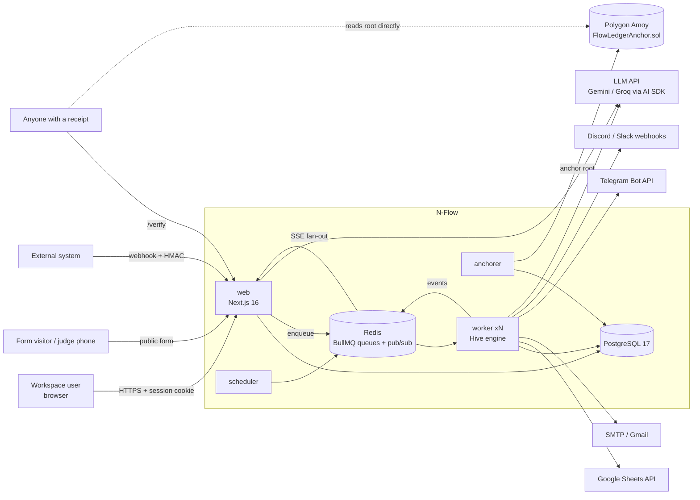
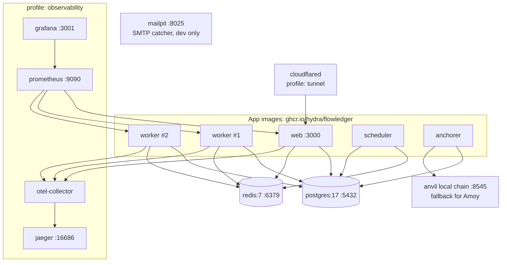
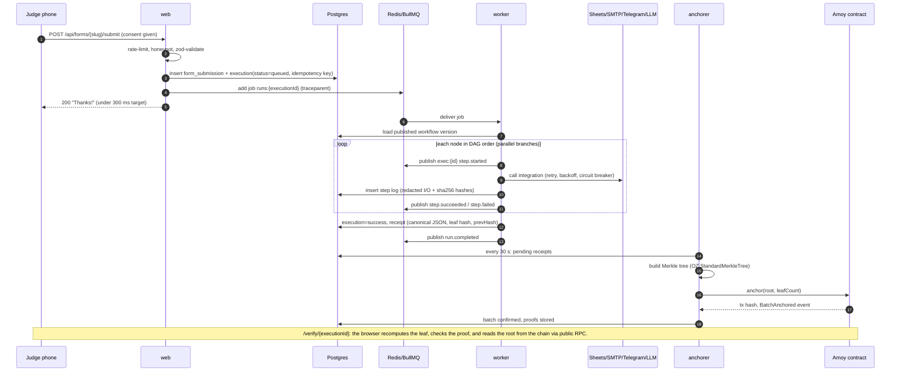

# 03 — Architecture

## Style
N-Flow is a **modular monolith with independently scalable process roles**. There is one TypeScript codebase in a pnpm/Turborepo monorepo, built into **one container image** that starts in one of four roles:

| Role | Command | Scales by | Responsibility |
|---|---|---|---|
| `web` | `next start` | CPU (HPA) | UI, API layer for the frontend, auth, ingress for triggers (forms/webhooks), SSE live events, public verify page |
| `worker` ("Worker Bees") | `node dist/worker.js` | Queue depth (KEDA) | Consumes `runs` jobs, executes workflow DAGs, writes step logs, emits events, builds receipts |
| `scheduler` | `node dist/scheduler.js` | 1 replica (leader) | Turns cron schedules into BullMQ repeatable jobs, sweeps retention, reconciles stuck runs |
| `anchorer` | `node dist/anchorer.js` | 1 replica (leader) | Batches receipts into a Merkle tree and anchors the root on Polygon Amoy, then confirms the transaction |

Why this design: we get microservice-style deployment (separate scaling, isolated failures, clear boundaries) without the cost of network calls between our own services, which matters in a hackathon.

## System context


## Container view (local `docker compose up`)


## Hero data flow: form submission → verified receipt


## Live updates
- The worker publishes events to the Redis channel `exec:{executionId}` and to `ws:{workspaceId}` (for the dashboard feed).
- `GET /api/executions/{id}/stream` is a Server-Sent Events (SSE) endpoint. It subscribes to the channel and forwards events. The canvas highlights nodes as events arrive.
- Fallback: poll `/status` every 1.5 s (the base template already does this).

## Multi-tenancy
- Every tenant-owned row has `workspace_id`. The data-access layer injects the workspace from the session, and handlers never trust a workspace id sent by the client.
- Defense in depth: Postgres row-level security (RLS) policies use `current_setting('app.workspace_id')`, set per transaction. Public endpoints (form submit, verify) go through narrow server functions.
- Each workspace has its own Redis key prefix and its own rate-limit buckets.

## Scaling and resilience
| Concern | Design |
|---|---|
| Burst of submissions | Ingress only writes and enqueues. Workers scale on queue depth: KEDA watches the Redis list `bull:runs:wait`. |
| Slow or flaky integration | Per-step timeout, exponential backoff with jitter (3 tries), a circuit breaker per integration and workspace, then the DLQ. |
| Worker crash mid-run | BullMQ detects the stalled job and redelivers it. Steps already succeeded (checkpointed in the DB) are skipped on resume, using `(execution_id, node_id)` as the idempotency key. |
| Duplicate webhook | An `Idempotency-Key` header (or a hash of the body) is unique per workflow for 24 h. The duplicate returns the original `executionId`. |
| Chain down or slow | Receipts stay `pending` and the anchorer retries. Runs never block on the chain, and the verify page shows "pending anchor". |
| DB down | Readiness probe fails, traffic drains, and the queue buffers work. |

## Repo layout (P1A)
```
flowledger/
  apps/
    web/                 # Next.js 16 app (fork of workflow-builder-template)
      app/ components/ lib/ plugins/   # plugins = integrations (UI metadata + step code)
      worker/            # entrypoints: worker.ts, scheduler.ts, anchorer.ts (bundled by tsup)
  packages/
    engine/              # pure-TS DAG executor, template resolution, retry policy
    ledger/              # canonical JSON, receipt hashing, Merkle, viem contract client
    db/                  # Drizzle schema, migrations, RLS SQL, seed
    config/              # zod env schema, shared tsconfig
  contracts/             # Hardhat 3 project: FlowLedgerAnchor.sol + tests + deploy
  deploy/
    docker/              # Dockerfile (multi-stage), .dockerignore
    compose/             # docker-compose.yml (+ observability, tunnel profiles)
    helm/flowledger/     # Helm chart: Deployments, HPA, KEDA ScaledObject, Ingress, NetPol, PDB
    observability/       # prometheus.yml, grafana dashboards, otel-collector.yaml
  .github/workflows/     # ci.yml, images.yml, kind-e2e.yml, codeql.yml
  docs/ design/ brand/
```
