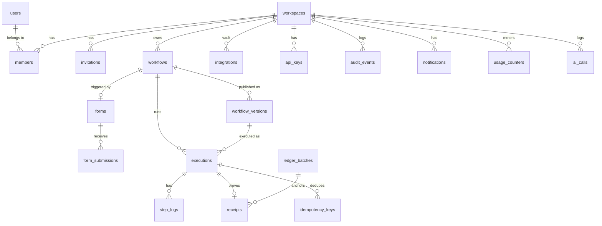

# 05 — Database

PostgreSQL 17 + Drizzle ORM. IDs are `text`, generated as nanoid (as in the base). All timestamps are `timestamptz`. Tables marked **(base)** come from the template and get extra columns.

## ERD

## Tables
### Identity (Better Auth: base + organization plugin)
| Table | Key columns |
|---|---|
| `users` (base) | id, name, email ⓤ, email_verified, image, two_factor_enabled, created_at |
| `sessions` (base) | id, token ⓤ, user_id, expires_at, ip_address, user_agent, **active_workspace_id** |
| `accounts` (base) | provider_id, account_id, tokens, password hash (scrypt via Better Auth) |
| `verifications` (base) | email verification / reset tokens |
| `workspaces` | id, name, slug ⓤ, logo, plan (`free`/`pro`/`business`), **dek_enc** (workspace data key wrapped by the master key), **key_version**, ai_data_sharing (bool), is_demo (bool), created_at |
| `members` | id, workspace_id, user_id, role (`owner`/`admin`/`editor`/`viewer`), ⓤ(workspace_id, user_id) |
| `invitations` | id, workspace_id, email, role, status, expires_at, inviter_id |
| `two_factors` | user_id, secret (encrypted), backup_codes (encrypted) |

### Automation
| Table | Key columns |
|---|---|
| `workflows` (base) | + **workspace_id**, **enabled** (bool, default false), **trigger_type**, **published_version_id**, **webhook_secret_enc**, created_by. The draft `nodes`/`edges` stay as jsonb |
| `workflow_versions` | id, workflow_id, version (int), definition (jsonb: nodes + edges), **definition_hash** (sha256 of canonical JSON), published_by, published_at. **Immutable.** |
| `forms` | id, workspace_id, workflow_id, slug ⓤ, title, description, fields (jsonb: `[{key,label,type,required,options}]`), consent_text, success_message, is_open, theme |
| `form_submissions` | id, form_id, workspace_id, data_enc (AES-GCM; this is personal data), ip_hash (salted), user_agent, consent_at, execution_id |
| `executions` (base `workflow_executions`) | + **workspace_id**, **version_id**, **trigger** (`form`/`webhook`/`schedule`/`manual`/`retry`), **status** (`queued`/`running`/`success`/`error`/`cancelled`/`skipped`), attempt, parent_execution_id (for retries), trace_id, idempotency_key, queued_at, started_at, **heartbeat_at**, completed_at, duration_ms |
| `step_logs` (base `workflow_execution_logs`) | + **attempt**, **input_enc / output_enc** (AES-GCM full data, used to resume and for the owner's verification, retention-limited), **input_preview / output_preview** (redacted jsonb for display), **input_hash / output_hash** = `sha256(salt ‖ JCS(full data))`, error, error_class, duration_ms. ⓤ(execution_id, node_id, attempt) |
| `idempotency_keys` | key, workflow_id, execution_id, created_at, expires_at. ⓤ(workflow_id, key) |
| `schedules` | id, workflow_id, cron, timezone (default `Asia/Kolkata`), next_run_at, bull_repeat_key |

### Proof-of-Execution
| Table | Key columns |
|---|---|
| `receipts` | execution_id (PK), workspace_id, receipt (jsonb canonical), **receipt_hash** (keccak256 of JCS), **salt** (16 random bytes, off-chain only; deleting it crypto-shreds the link), **prev_receipt_hash** (per-workspace hash chain), batch_id, leaf_index, proof (jsonb `bytes32[]`), status (`pending`/`anchored`), created_at |
| `ledger_batches` | id (serial), **chain_batch_id** (read from the `BatchAnchored` event), merkle_root, leaf_count, chain_id, contract_address, tx_hash, block_number, status (`building`/`submitted`/`confirmed`/`failed`), gas_used, error, created_at, confirmed_at |
| `tamper_events` | id, workspace_id, execution_id, node_id, field, at, actor. Demo workspace only, so the tamper simulation is honest and on the record |

### SaaS, ops and security
| Table | Key columns |
|---|---|
| `integrations` (base) | + **workspace_id**, **key_version**, status (`ok`/`error`/`untested`), last_tested_at, last_error. `config` stays AES-256-GCM encrypted |
| `api_keys` (base) | + **workspace_id**, scopes (`runs:trigger`, `workflows:read`, …), expires_at, revoked_at |
| `audit_events` | id, workspace_id, actor_user_id, action (`workflow.enable`, `integration.create`, `member.role_change`, …), target_type, target_id, ip_hash, user_agent, metadata, at |
| `notifications` | id, workspace_id, user_id (null = everyone), kind, title, body, link, read_at, created_at |
| `usage_counters` | workspace_id, period (`2026-10`), runs, steps, ai_tokens. PK(workspace_id, period) |
| `ai_calls` | id, workspace_id, feature (`copilot`/`node`/`doctor`/`mapper`), provider, model, input_tokens, output_tokens, latency_ms, ok, created_at |

## Indexes (hot paths)
- `executions (workspace_id, created_at desc)`, `executions (workflow_id, status)`, `executions (status) where status in ('queued','running')`
- `step_logs (execution_id, started_at)`
- `receipts (status) where status = 'pending'`, `receipts (workspace_id, created_at)`
- `form_submissions (form_id, created_at desc)`
- `audit_events (workspace_id, at desc)`

## Tenancy and RLS
- The app layer checks the workspace in every repository function, using `ctx.workspaceId` from the session.
- RLS policies on tenant tables: `using (workspace_id = current_setting('app.workspace_id', true))`. The app sets this with `set_config(..., true)` inside each transaction. Workers set it per job.
- Public routes (form submit, verify) use explicit, narrow queries keyed by slug or execution id. They never expose other rows.

## Retention and privacy
- `form_submissions.data_enc`: kept 90 days on Free and 365 days on paid plans. Deleted (crypto-shredded by dropping the row) on a data-subject request.
- On-chain receipts contain hashes only, so deleting the off-chain data leaves an unlinkable hash. This is the DPDP/GDPR "erasure vs. immutability" answer.
- Step log previews are redacted: emails, phone numbers and tokens are masked by `lib/utils/redact.ts` from the base, extended for Indian phone and Aadhaar-like patterns. Full data is stored only encrypted (`*_enc`) and is purged by retention.
- Hashes are salted per execution, so a hash of low-entropy personal data (e.g. an email) cannot be brute-forced. Deleting the salt makes the anchored hash permanently unlinkable.

## Migrations and seed
- `drizzle-kit generate` → SQL in `packages/db/migrations`. RLS policies live in a hand-written SQL migration.
- Seed: a demo workspace "TRNT BEE Demo", 5 templates, the hero workflow with its published form, and about 30 historical runs so the dashboard charts aren't empty. All seeded runs are labeled "seeded" in the UI.
