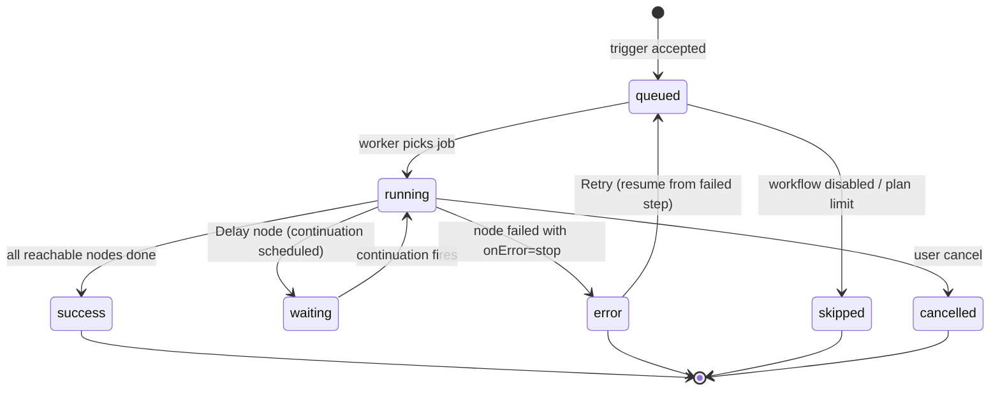

# 07 — Hive Engine (execution core)

Hive replaces the base template's Workflow DevKit runtime with our own **durable, queue-based DAG executor** (D-004). The pure logic (`packages/engine`) has no I/O, so it is unit-testable. The I/O adapters (queue, DB, integrations, events) live in the worker.

## Queues (BullMQ on Redis)
| Queue | Job | Producer | Notes |
|---|---|---|---|
| `runs` | `{executionId, workspaceId, versionId, traceparent}`. `jobId = executionId` (queue-level dedupe) | web ingress, scheduler, retry API | Worker concurrency 10 per process. Job attempts 3 for *infrastructure* errors |
| `runs-dlq` | The failed job plus its last error | worker `failed` handler | Shown in Admin → Queues. Re-drive button |
| `continuations` | `{executionId, resumeFromNodeId}`, delayed | Delay node | **Durable timers.** No sleeping worker; the run checkpoints and exits |
| `schedules` | Job scheduler per scheduled workflow (`upsertJobScheduler`, cron + tz) | scheduler | Fires → creates an execution → `runs` |
| `anchor` | Repeatable: every 30 s in demo mode, 5 min in prod | scheduler | Consumed by the anchorer only |
| `maintenance` | Retention sweep, stuck-run reconciler (running > 10 min with no heartbeat → requeue) | scheduler | Hourly |

To keep Upstash command usage down on its free tier, tune BullMQ: `drainDelay: 30`, `stalledInterval: 300000`. Local and demo runs use the Redis container, which has no limits.

## Execution lifecycle

Step states: `pending → running → success | error | skipped (branch not taken / node disabled) | retrying`.

## DAG semantics
**At publish time, the validator checks:**
- There is exactly one trigger and the graph is acyclic (Kahn's algorithm).
- Every node is reachable from the trigger.
- Required config is present.
- Every integration id belongs to the workspace.
- Template references `{{@nodeId:…}}` point only to *upstream* nodes.
- Condition and Switch output handles are wired.

**At run time:**
- **Kahn scheduler.** A node becomes *ready* when every incoming edge is *resolved*. Ready nodes run in parallel, capped at 4 per run.
  - An edge is **active** if its source succeeded on that handle (`true`/`false` for Condition, `case-x` for Switch, `default` for others). It is **inactive** if its source was skipped or took the other branch.
  - A node runs if at least one incoming edge is active (an OR-join). It is skipped if all incoming edges are inactive. A skip propagates downstream.
  - This fixes the base template's recursive traversal, which could run a join node before all its parents had finished. That's worth a slide.
- **Data passing.** Outputs are keyed by node id. Templates are resolved just before each step with the base `processTemplates` logic, moved into `packages/engine`. Job data never carries secrets: a step receives only an `integrationId` and decrypts credentials inside the worker (pattern from the base).
- **Error policy per node:** `onError = stop` (default; run → error, downstream skipped), `continue` (log the error, continue with `null` output), or `branch` (follow the node's `error` handle).

## Reliability features
| Feature | Implementation |
|---|---|
| Retries | Per node: `maxAttempts` (default 3). Exponential backoff, base 1 s, ×2, full jitter, cap 30 s. Honors `Retry-After`. Only for retryable errors: network, timeout, 429, 5xx |
| Error classes | `retryable` · `auth` (bad or expired credential → Run Doctor suggests reconnecting) · `validation` (bad config or data → Doctor suggests a config patch) · `fatal` |
| Timeouts | `AbortController` per step: 30 s default, 60 s for AI, 10 s for HTTP |
| Checkpoint / resume | Each successful step is persisted in `step_logs` before the next one starts. On redelivery or Retry, completed `(execution_id, node_id)` steps are loaded rather than re-executed. Their encrypted outputs rebuild the context |
| Idempotency | Ingress: an `Idempotency-Key` or body hash is unique per workflow for 24 h. Steps: `idempotencyKey = executionId:nodeId` is passed to providers that support it. **Delivery is honestly "at-least-once, effectively-once where the provider supports idempotency keys."** |
| Circuit breaker | Per (workspace, integration) with opossum (Apache-2.0). It opens at 50% failures over 10 calls in 30 s and goes half-open after 30 s. While open: fail fast with `retryable`, and the job is delayed |
| Fairness | A Redis token bucket per workspace (Free: 2 concurrent runs, Pro: 10) stops one tenant starving the others |
| Heartbeat | The worker updates `executions.heartbeat_at` every 5 s. The reconciler requeues dead runs |
| Graceful shutdown | On SIGTERM: stop taking jobs, finish in-flight steps (≤ 25 s), close connections. This matters for Kubernetes rolling updates |

## Events and telemetry
- Redis pub/sub: `exec:{id}` (step and run events) and `ws:{workspaceId}` (dashboard feed) feed SSE in `web`.
- OpenTelemetry spans: `ingress` → `queue.wait` → `run` → `step:{action}` → outbound HTTP. The `traceparent` header is carried in job data, so one trace covers the whole request.
- Prometheus metrics:
  - `flowledger_runs_total{status,trigger}`
  - `flowledger_step_duration_seconds{action}` (histogram)
  - `flowledger_queue_depth{queue}`
  - `flowledger_retries_total{action}`
  - `flowledger_circuit_open{integration}`
  - `flowledger_anchor_batches_total{status}`
  - `flowledger_ai_tokens_total{feature}`

## Step contract (all integrations)
```ts
type StepResult<T> = { success: true; data: T } | { success: false; error: { message: string; class: ErrorClass; retryAfterMs?: number } };
type StepFn<I, O> = (input: I & { integrationId?: string; _context: StepContext; signal: AbortSignal }) => Promise<StepResult<O>>;
```
Plugins keep the base template's layout: `plugins/<name>/{index.ts, credentials.ts, icon.tsx, steps/*.ts, test.ts}`. New plugins:
- `google-sheets`
- `smtp-email`
- `telegram`
- `discord`
- `notify`
- `ai` (generate, classify, extract, draft-email, summarize)
- `logic` (switch, delay, transform)
- `form` trigger

## Tests (P1C)
- **Engine unit tests (vitest, no I/O):**
  - linear, parallel and diamond joins
  - condition true/false, switch, disabled node
  - error policies, retry/backoff timing (fake timers)
  - resume from a checkpoint
  - template resolution
  - validator rejecting cycles and dangling references
- **Integration tests** with a real Redis (CI service container): enqueue → worker → DB rows → events; a duplicate idempotency key returns the same execution; a killed worker → the stalled job is redelivered → no duplicate side effects (mock integration counts calls).
